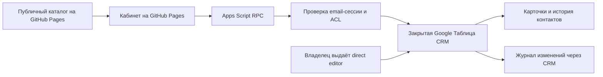

# Разбор разработки CRM на Google Таблицах

Дата разбора — 11 ноября 2026 года, московское время.

Из регионального исследования получился публичный каталог компаний и отдельный кабинет менеджера с карточками, канбаном, историей контактов и журналом. Рабочее хранилище — закрытая Google Таблица; кабинет опубликован на GitHub Pages, серверная часть — Apps Script. Текущий основной вход использует email-код.

Готовность ограничена доказательствами. Владелец проходил живой вход и проверял запись с журналом. Полный маршрут приглашённого менеджера ещё не подтверждён. Ранее проблемный адрес при свежей проверке уже добавлен редактором. Журнал фиксирует изменения через API CRM, прямые ручные правки таблицы в него не входят.

В этом запросе проведены чтение исходников, текущего ACL и схемы; перечитаны 178 уникальных ID. Production код, развёртывание, права и рабочие карточки не изменялись. Новые письма не отправлялись, новый живой тест авторизации/сохранения не проводился. Исторические проверки приводятся с их датами. Суммарное время разработки, стоимость, выручка, число активных менеджеров и конверсии не измерялись; такие показатели не выдумываются.

## Архитектура

Три независимых вопроса — кем представился посетитель, есть ли у подтверждённого пользователя право на CRM и было ли письмо реально доставлено. Смешение этих вопросов стало основной причиной повторных неудачных инструкций. Публичный endpoint не делает CRM публичной, когда каждое приватное действие проверяет сессию и роль на сервере.

## Оценка результата

Полезный результат — 178 рабочих карточек, девять этапов, восемь рабочих полей, пять типов контакта, редактирование, смена этапа и аудит. Слабые места — недоказанный маршрут приглашённого пользователя, диагностика отдельных отправок, отсутствие идемпотентности контактов, ограниченный охват аудита, отсутствие нагрузочного и restore-теста. Это рабочий небольшой инструмент с перечисленными границами, а не доказанная промышленная CRM со всеми функциями.

Ниже восстановлен весь путь. Точные даты указываются только там, где есть наблюдение. Числа рынка и графики — контекст исходного продукта; данная работа не проводит повторное исследование первоисточников Росстата или автомобильного рынка.

## Итог

| Параметр | Результат | Граница доказательства |
| --- | --- | --- |
| Дата разбора | 11.11.2026, Europe/Moscow | Текущие API-чтения отделены от исторических тестов |
| Продукт | Публичный каталог + закрытый кабинет менеджера | Карточки, этапы, контакты и аудит |
| Сайт | https://locanilia377-commits.github.io/fiverox-chechnya/ | Публичный GitHub Pages |
| Кабинет | https://locanilia377-commits.github.io/fiverox-chechnya/cabinet.html | Статическая UI; сервер Apps Script; email OTP |
| Архитектура | GitHub Pages → Apps Script RPC → закрытая Google Таблица | Отдельный публичный каталог; роли на сервере |
| Данные сейчас | 178 | Уникальные ID перечитаны из закрытой CRM 11.11 |
| Этапы / рабочие поля / контакты | 9 / 8 / 5 | Бизнес-конфигурация в Code.gs |
| Доступ сейчас | 1 владелец + 3 персональных редактора | Ранее проблемный адрес уже добавлен; доставки не доказывает |
| Проверено владельцем | OTP-вход 09.11; сохранение/аудит 08.11 | Исторические результаты, не новый E2E 11.11 |
| Главный открытый хвост | Полный маршрут приглашённого менеджера | Код, вход, правка и журнал редактором не подтверждены |
| Граница журнала | Изменения через CRM API | Ручные правки Sheets и подделка самим редактором не исключены |
| Другие провайдеры | Яндекс заготовка; телефон/Apple не подключены | Текущий standalone кабинет только email |
| Масштаб | Нагрузка и restore не проверены | 178 карточек не доказательство масштабируемости |
| Результат задачи | Навык google-sheets-crm + аналитический разбор | Production код и права этим запросом не изменялись |

## Пройденные шаги

| Шаг | Этап | Запрос / действие | Результат | Подробность | Статус доказательства | Правило для следующих задач | Источник |
| --- | --- | --- | --- | --- | --- | --- | --- |
| 01 | Исследование региона | 2ГИС + Яндекс, сайт и таблица | Создана база, ставшая основой CRM | 178 уникальных лидов; 67 подтверждённых в исследовании | Исторический манифест; 178 ID перечитаны 11.11 | Стабильные ID, публичные и рабочие данные разделять | github-publication.json |
| 02 | Публикация | Перенос результата на GitHub Pages | Канонический публичный сайт и ссылка в таблице | HTTP 200 и совпадение сборки зафиксированы в релизе | Историческая проверка, не новый браузерный тест | Проверять основной URL без входа после deploy | github-publication.json |
| 03 | Рынок и источники | Сверка референса, данных и визуализации | 11 графиков сайта, 5 в таблице в манифесте | Наличие графиков не подтверждает каждый запрошенный первоисточник | Контекст исследования | Источник, определение, территория и период обязательны для сравнения | github-publication.json |
| 04 | Калькулятор | Редактирование значений и сохранение после refresh | localStorage, исходные значения и сброс корзины | Локальная настройка на устройстве | Код + историческая browser QA | Не смешивать localStorage калькулятора и совместную CRM | source-followup/site/app.js |
| 05 | Публичные карточки | Убрать полотна текста, сохранить фильтры | Компактные карточки города/услуг/цен, раскрытие деталей | Публичный каталог сохранён отдельно от CRM | Код + историческая browser QA | Публичная и рабочая карточки имеют разные поля | github-publication.json |
| 06 | Хранилище CRM | Добавить рабочие функции менеджера | Отдельный закрытый CRM-файл | Карточки, очередь, история, журнал; 178 ID | Структура и ACL перечитаны 11.11 | Закрытые данные не помещать в публичную исследовательскую таблицу | source-followup/crm/web/Code.gs:1 |
| 07 | Первый доступ | Вход только владельцу через Google | Проверка owner/editor на сервере | Личность зависит от режима Apps Script | Исторический вариант | Аутентификация и право редактирования — разные проверки | source-followup/crm/web/Code.gs:14 |
| 08 | Бизнес-процесс | Добавить тестирование материала | 9 этапов, включая два этапа тестирования | Этапы присутствуют в действующем локальном коде | Код | Не терять согласованные этапы при миграции | source-followup/crm/web/Code.gs:3 |
| 09 | Отдельная вкладка | Вынести CRM из текста | Сначала вкладка сайта #crm, затем отдельный кабинет | Вкладка сайта, браузера и iframe различаются | Историческая эволюция | Проверять конечный маршрут по кнопке | github-publication.json |
| 10 | Форма карточки | Редактирование непосредственно на сайте | 8 рабочих полей, серверный save | Перечитывание, валидация и защита конфликтов | Код + прежний живой тест владельца | Форма сама по себе не доказывает сохранение | source-followup/crm/web/Code.gs:205 |
| 11 | Кнопки | Исправить некликабельный вход и неактивный редактор | Исправлялись UI и ссылки, выполнялись новые deployments | Повторяющиеся пользовательские ошибки | История запросов | Проверять реальную кнопку и наблюдаемый экран, не инструкции по памяти | github-publication.json |
| 12 | Google без ручной Cloud-настройки | Использовать Apps Script | Прямой Google-маршрут работал у владельца в отдельных условиях | Multi-login приводил к /macros/u/3 и ошибке Google Диска | Ошибка воспроизводилась исторически | Инкогнито — диагностика, успех владельца не доказывает вход команды | https://developers.google.com/apps-script/guides/support/troubleshooting#issues_with_multiple_google_accounts |
| 13 | Канбан | Перетаскивание между этапами с сохранением | crmMove проверяет предыдущий этап и возвращает конфликт | Есть изменение этапа в форме на мобильном | Код + прежний тест владельца | Серверный этап авторитетен; нужен мобильный сценарий | source-followup/crm/web/Code.gs:253 |
| 14 | Командные права | Разрешать работу редакторам владельца | Owner → admin; direct writer → editor | ACL проверяется на каждом приватном запросе | Код; текущий ACL 11.11 | Право на публичный файл не означает право на закрытую CRM | source-followup/crm/web/EmailAuth.gs:51 |
| 15 | Видимость | Сначала полная воронка публично, затем только карточки | Последнее решение оставляет рабочую CRM закрытой | Этапы, заметки, история и аудит требуют входа | Последнее согласованное решение | Позднее уточнение заменяет прежнее разрешение | Переписка пользователя |
| 16 | Провайдеры входа | Запрошены телефон, Google, Apple, Яндекс | Текущий кабинет использует email OTP | Локальный Яндекс-заготовка; телефон/Apple не подключены | Проверено по сборщику | Файл или кнопка не означают работающий провайдер | source-followup/crm/web/build_cabinet.py:20 |
| 17 | Журнал | Показывать кто, когда и что изменил | Advanced Google Sheets API v4 + audit batchUpdate | Пользователь добавил правильный сервис после ошибки выбора | Код + историческая настройка | Проверять сервис Sheets v4 и идентификатор Sheets | source-followup/crm/web/Audit.gs:29 |
| 18 | Тест сохранения | Проверить тестовую карточку и журнал | Правка владельца, автор, МСК, before/after подтверждены | Тестовые карточка и событие очищены; осталось 178 | Исторический тест 08.11 02:51:17 МСК | Записывать время/версию теста; не выдавать старый тест за новый | github-publication.json |
| 19 | Новый маршрут входа | Убрать объяснения входа для каждого менеджера | Статический cabinet.html на Pages + Apps Script OTP RPC | Browser Google cookies не используются | Сборщик и исторический production тест | Вход по почте отделён от Google browser-сессии | source-followup/crm/web/build_cabinet.py:27 |
| 20 | Отправка писем | Владелец подтвердил MailApp consent | Setup и отправка стали разрешены | Consent не доказывает фактическую доставку | Историческая настройка | Проверять реальное письмо из опубликованной формы | source-followup/crm/web/EmailAuth.gs:84 |
| 21 | Недоставка | Проверить обе почты | Владелец получил код и открыл 178 карточек | 09.11 около 13:35 МСК; менеджер не проверен | Историческое наблюдение владельца | Успех отправителя/владельца не заменяет тест получателя | github-publication.json |
| 22 | Gmail | Исправить dotted-вариант адреса | В OTP v10 точки игнорируются только у consumer Gmail | Повторный вход владельца около 13:48 МСК прошёл | Исторический тест + код | Сохранять точный ACL-адрес как доставку и actor | source-followup/crm/web/EmailAuth.gs:46 |
| 23 | Адрес менеджера | Уточнён конкретный email при недоставке | 09.11 адрес отсутствовал в ACL нужной CRM | Это исторически объясняло отказ отправки | Историческое наблюдение | Сначала точный email и правильный file ID, затем транспорт | Предыдущая проверка ACL |
| 24 | Повторная сверка | Проверка состояния для этого разбора | 11.11 нужный адрес уже direct writer | 1 owner + 3 named writers; нет anyone/domain; 178 уникальных ID | Свежая проверка API 11.11.2026 | Права могли измениться; не повторять устаревшую причину | Drive metadata + Карточки!A2:A500 |
| 25 | Незавершённый маршрут | Вход и работа приглашённого менеджера | Нет подтверждения доставки, входа и save/audit редактором | В разборе статус не проверено | Пробел приёмки | Сквозной тест приглашённого пользователя — отдельный критерий | github-publication.json |
| 26 | Систематизация | Разобрать все действия и сделать навык | Отчёт, таблица и google-sheets-crm | Работа этого запроса; production код не менялся | Текущие артефакты | Использовать уроки как процедуру, а не копировать частные настройки | skills/google-sheets-crm/SKILL.md |

## Параметры CRM

| Область | Параметр | Значение | Подтверждение | Ограничение / смысл | Источник |
| --- | --- | --- | --- | --- | --- |
| Данные | Карточки | 178 уникальных ID | Текущее чтение 11.11 | Число строк не доказывает качество или нагрузочную способность | Карточки!A2:A500 |
| Данные | Исходные поля | 9 полей A:I | Заголовок перечитан 11.11 | ID; компания; город; адрес; услуги; телефоны; каналы; 2ГИС; Яндекс | source-followup/crm/web/Code.gs:175 |
| Данные | Рабочие поля | 8 полей J:Q | Заголовок перечитан 11.11 | Этап; ответственный; следующий контакт; следующий шаг; последний контакт; заметка; оценка; причина отказа | source-followup/crm/web/Code.gs:6 |
| Процесс | Этапы | 9 | Код | Новый → В работе → Связались → КП отправлено → Переговоры → Согласовано тестирование → Проведено тестирование материала → Клиент / Отказ | source-followup/crm/web/Code.gs:3 |
| Процесс | Типы контактов | 5 | Код | Звонок; Сообщение; Встреча; Отправка КП; Другое | source-followup/crm/web/Code.gs:5 |
| UI | Список / доска / карточка | Реализованы | Код + прошлые тесты | Воронка, фильтры по этапу и сроку, поиск компании/города/ID | source-followup/crm/web/Crm.html:99 |
| UI | Мобильная смена этапа | Через форму | Код | Перетаскивание не является единственным способом | source-followup/crm/web/Crm.html:600 |
| Доступ | Активные роли | admin / editor | Код + ACL 11.11 | Owner и direct writer; viewer в enum не означает реализованный reader flow | source-followup/crm/web/EmailAuth.gs:51 |
| Доступ | Право редактирования | Из ACL закрытого CRM-файла | Текущее состояние | Прямое право Sheets позволяет обходить API и журнал | source-followup/crm/web/EmailAuth.gs:51 |
| Доступ | Актуальность прав | Каждый приватный запрос | Код | После отзыва следующий запрос должен отказать; текущий живой revoke не выполнялся | source-followup/crm/web/EmailAuth.gs:267 |
| Вход | Текущий основной способ | Email OTP | Код + исторический deploy v10 | Это не Google OAuth; Google cookies не нужны | source-followup/crm/web/build_cabinet.py:20 |
| Вход | Код / TTL / попытки | 8 цифр / 10 мин / 5 | Код | Одноразовый код, HMAC, browser proof | source-followup/crm/web/EmailAuth.gs:1 |
| Вход | Повтор отправки | 90 секунд | Код | Ограничение повторного расхода почты | source-followup/crm/web/EmailAuth.gs:8 |
| Вход | Лимиты на ящик | 3/час; 8/сутки | Код | Dotted Gmail использует общий mailbox key | source-followup/crm/web/EmailAuth.gs:166 |
| Вход | Общий лимит приложения | 25/час; 80/сутки | Код | Отдельно действует остаток MailApp; лимиты не означают доставку | source-followup/crm/web/EmailAuth.gs:167 |
| Вход | Лимит consumer MailApp | 100 получателей/сутки на дату проверки | Официальная документация 11.11 | Квоты изменяемы, читать реальный остаток | https://developers.google.com/apps-script/guides/services/quotas |
| Вход | Публичный ответ start | Одинаковый true | Код | Не раскрывает допуск; нельзя писать письмо отправлено по этому ответу | source-followup/crm/web/EmailAuth.gs:185 |
| Вход | Диагностика | Reason-only console outcomes | Код | Нет полноценной админ-панели доставки и корреляции с конкретной попыткой | source-followup/crm/web/EmailAuth.gs:185 |
| Идентичность | Gmail dots | Только подходящий @gmail.com | Код + тест владельца 09.11 | Корпоративные, plus и googlemail не обобщены | source-followup/crm/web/EmailAuth.gs:46 |
| Сессия | TTL / число | 12 часов / до 5 | Код | Logout удаляет серверную сессию | source-followup/crm/web/EmailAuth.gs:6 |
| Сессия | Хранение клиента | Память вкладки | Сборщик | После обновления нужен повторный вход; калькулятор хранится иначе | source-followup/crm/web/build_cabinet.py:77 |
| API | RPC | 9 разрешённых методов | Код | Start, Verify, Logout, Session, List, Read, Save, Move, Record | source-followup/crm/web/EmailRpc.gs:21 |
| API | Транспорт | POST text/plain JSON; credentials omit | Сборщик | Редирект ContentService и CORS проверялись исторически; не новая browser QA | source-followup/crm/web/build_cabinet.py:27 |
| API | Размер запроса | До 65 000 символов | Код | Проверяется MIME, метод и число аргументов | source-followup/crm/web/EmailRpc.gs:5 |
| Запись | Конфликты | ScriptLock + сравнение исходных 8 полей | Код + прошлый тест | Lock не блокирует прямого редактора Sheets | source-followup/crm/web/Code.gs:193 |
| Запись | Формулы | Нетронутые промежуточные формулы сохраняются | Код + прошлый тест | Формульные заметки пишутся как текст | source-followup/crm/web/Code.gs:232 |
| Запись | Атомарность | Правка + аудит одним batchUpdate | Код + прежняя живая запись | Совместное применение API; не полная изоляция от соавторов | source-followup/crm/web/Audit.gs:29 |
| Запись | Идемпотентность контакта | Не реализована | Кодовый анализ | Потеря ответа и ручной повтор могут создать дубликат | source-followup/crm/web/Code.gs:273 |
| Журнал | Колонки | 7 | Код | Когда МСК; actor; действие; ID; компания; JSON diff; UUID | source-followup/crm/web/Audit.gs:55 |
| Журнал | Охват | Только CRM API | Кодовый анализ | Ручные правки Sheets и изменения журнала прямыми редакторами не охвачены | source-followup/crm/web/Audit.gs:29 |
| Журнал | Показ истории | 20 последних контактов и 20 событий | Код | Actor контакта записан в E Истории, но read читает A:D; виден в аудите | source-followup/crm/web/Code.gs:180 |
| Провайдеры | Яндекс | Заготовка, не активный кабинет | Сборщик + код | Локальный Auth.gs не доказывает deployed provider | source-followup/crm/web/Auth.gs |
| Провайдеры | Телефон / Apple | Не подключены | Аудит исходников | Потребуются отдельные интеграции и проверка доставки/callback | Локальные исходники |
| Релиз | Версии | Legacy Google v7 / email v10 | Исторический manifest | Исторические QA разных вариантов смешаны; нужна матрица по release | github-publication.json |
| Масштаб | Нагрузка / latency | Не измерены | Пробел доказательств | Лист и история сканируются; 178 карточек не являются нагрузочным тестом | source-followup/crm/web/Code.gs:160 |
| Резервирование | Восстановление | Не подтверждено тестом | Пробел доказательств | Нужны snapshot и проверенный restore, а не только наличие файла на Drive | Разбор доказательств |

## Ошибки и решения

| ID | Приоритет | Проблема | Причина | Что сделано / статус | Критерий закрытия | Следующее действие | Источник |
| --- | --- | --- | --- | --- | --- | --- | --- |
| I01 | P0 до командного запуска | Приглашённый менеджер не прошёл полный маршрут | Тест владельца подменял командную приёмку | Функция реализована, результат редактора не проверен | Доставка → вход → карточка → save → ячейка → actor/time/diff | Согласованный тест менеджером на выделенной карточке | github-publication.json |
| I02 | P1 | Повторные ошибки Google Диска при входе | Прямой Apps Script multi-login маршрут | Основной маршрут заменён статическим OTP-кабинетом | Обычный браузер с несколькими аккаунтами открывает кабинет | Не возвращать legacy /exec как основной вход | Официальный Apps Script troubleshooting |
| I03 | P1 | Код принят, но письма может не быть | Одинаковый ответ скрывает ACL/лимиты/транспорт | Честный текст UI и reason-only logs уже есть | Админ видит безопасный исход конкретной попытки | Добавить correlation ID, TTL и приватную диагностику | source-followup/crm/web/EmailAuth.gs:185 |
| I04 | P1 | Недоставка конкретному адресу 09.11 | Адрес отсутствовал в правильном ACL | 11.11 уже direct writer; старая причина устарела | Текущий адрес допущен и реальная доставка проверена | Не повторять устаревшую диагностику; сверять текущий ACL | Drive metadata 11.11 |
| I05 | P1 | Журнал воспринимается как все изменения | Прямые Sheets editors обходят приложение | Ограничение архитектуры, не устранено | Охват назван точно или менеджеры работают только через API | Для строгого аудита отдельный реестр доступа и защищённый журнал | source-followup/crm/web/Audit.gs |
| I06 | P1 | Дубли контактов после потерянного ответа | Нет client operation ID и дедупликации | Обнаружено в коде, не исправлялось этим запросом | Повтор того же запроса возвращает тот же результат без нового события | Реализовать идемпотентность и тест потери ответа | source-followup/crm/web/Code.gs:273 |
| I07 | P2 | Смешаны текущие и legacy проверки | Накопительный manifest без версий сценариев | Создан новый шаблон паспорта выпуска в навыке | Для каждого теста version/route/time/role/evidence | Разнести active/legacy и не наследовать passed при смене входа | github-publication.json |
| I08 | P2 | Автор не виден в контактной истории | История пишет A:E, read возвращает A:D | В журнале автор есть, в истории интерфейса нет | Контакт показывает проверенного actor там, где обещано | Расширить контракт чтения и UI истории | source-followup/crm/web/Code.gs:180 |
| I09 | P2 | Refresh завершает кабинетную сессию | Токен хранится только в памяти | Текущее осознанное поведение | Ясная политика входа; сохранённые данные не теряются | Не обещать remember-me без отдельного механизма | source-followup/crm/web/build_cabinet.py:77 |
| I10 | P2 | Нет подтверждения производительности | Полные сканирования и нет замеров | Не проверено | Согласованный объём, параллелизм и latency/error budget | Замерить чтение/запись/конфликты и квоты до роста | Код + пробел нагрузочных данных |
| I11 | P2 | Провайдеры могут считаться подключёнными по файлам | Локальные заготовки и разные поколения UI | В текущем кабинете только email | Каждый провайдер имеет реальный end-to-end callback/login test | Отдельные интеграционные задачи для Google OAuth/Яндекс/Apple/телефона | source-followup/crm/web/build_cabinet.py:20 |
| I12 | P2 | Google Sheets воспринимается как полноценная транзакционная БД | Lock/batchUpdate переоцениваются | Граница платформы | Прямые каналы и конкуренция явно учтены | Если нужны строгие роли и аудит — оценить закрытый backend/БД | https://developers.google.com/workspace/sheets/api/reference/rest/v4/spreadsheets/batchUpdate |
| I13 | P2 | Нет проверенного восстановления | Не предъявлен restore-тест | Не проверено | Восстановлена копия данных и совместимой версии сервера | Определить backup/RPO/RTO с владельцем и проверить restore | Разбор доказательств |

## Матрица приёмки

| ID | Сценарий | Ожидаемый результат | Фактический статус | Когда / где проверялось | Ограничение | Доказательство |
| --- | --- | --- | --- | --- | --- | --- |
| T01 | Закрытость файла | Без anyone/domain, только owner/direct writers | Проверено сейчас | 11.11.2026, metadata | Не доказывает весь API deny | Drive metadata |
| T02 | Уникальность карточек | 178 непустых ID и 178 уникальных | Проверено сейчас | 11.11.2026, A2:A500 | Не проверялись все рабочие значения | Карточки!A2:A500 |
| T03 | Схема | 17 заголовков соответствуют контракту | Проверено сейчас | 11.11.2026, A1:Q1 | Формулы не перечитывались массово | Карточки!A1:Q1 |
| T04 | OTP владельца | Реальное письмо, вход, 178 карточек | Исторически пройдено | 09.11.2026 около 13:35 МСК, OTP | Не тест менеджера | github-publication.json |
| T05 | Dotted Gmail | Доставка владельцу по авторитетному адресу и вход | Исторически пройдено | 09.11.2026 около 13:48 МСК, v10 | Не корпоративные алиасы | github-publication.json |
| T06 | Правка и журнал владельца | Ячейка, повторное чтение, actor/time/before-after | Исторически пройдено | 08.11.2026 02:51:17 МСК | Последующие обновления не делают тест новым | github-publication.json |
| T07 | Перенос этапа / формулы | Этап сохранён, нетронутые формулы целы | Исторически пройдено | Прежний owner live-test, manifest | Версия теста не детализирована | github-publication.json |
| T08 | Полный маршрут редактора | Письмо → вход → правка → таблица → журнал | Не проверено | 11.11.2026, разбор доказательств | Обязателен для команды | Разбор |
| T09 | Отзыв / logout / replay | Старый token не читает и не пишет | Подтверждено кодом | EmailAuth.gs | Production revoke/replay не выполнялся этим запросом | source-followup/crm/web/EmailAuth.gs:267 |
| T10 | OTP negative cases | Истёкший/неверный/повторный код, лимиты | Подтверждено кодом | EmailAuth.gs | Полной актуальной browser-матрицы нет | source-followup/crm/web/EmailAuth.gs:225 |
| T11 | Недопущенный пользователь | Нет приватных данных и записи | Подтверждено кодом | RPC + context | Нужна проверка опубликованного маршрута | EmailRpc.gs + EmailAuth.gs |
| T12 | Две конкурентные карточки | Нет тихой перезаписи чужих данных | Подтверждено кодом | crmSave / crmMove | Не защищает ручную правку Sheets | source-followup/crm/web/Code.gs:205 |
| T13 | Отказ журнала | Правка и событие отклонены вместе | Подтверждено кодом | Единый batchUpdate | Разрушающий тест только в тестовой среде | source-followup/crm/web/Audit.gs:29 |
| T14 | Потерянный ответ контакта | Повтор не создаёт дубль | Не реализовано | Аудит кода 11.11 | Серверный UUID не является дедупликацией | source-followup/crm/web/Code.gs:273 |
| T15 | Обычный браузер / mobile / кнопка | Реальный production маршрут без Google browser-login | Исторически пройдено | Прежние Safari/Pages QA | Не новая проверка браузером 11.11 | github-publication.json |
| T16 | Backup / restore | Восстановленная копия и совместимые версии | Не проверено | Разбор доказательств | Наличие файла не доказывает backup | Разбор |
| T17 | Нагрузка | Измеренная задержка и ошибки на согласованном объёме | Не проверено | Разбор доказательств | 178 записей не нагрузочный тест | Разбор |
| T18 | Навык | Валидация структуры, ссылок и независимые сценарии | Пройден независимый dry run | 11.11.2026; 3 сценария; замечания исправлены | Это проверка поведения навыка, не production CRM | google-sheets-crm |

## План развития

| Порядок | Работа | Кто участвует | Условие | Измеримый результат | Приоритет |
| --- | --- | --- | --- | --- | --- |
| 1 | Командная приёмка | Владелец/приглашённый менеджер + разработчик | Есть разрешение в ACL; согласован тест получателя | Вход и правка приглашённого редактора проверены в таблице/журнале | P0 |
| 2 | Диагностика доставки | Разработчик | Приватный доступ администратора к исходам | Correlation ID + исход отправки + TTL; никаких секретов в публичном ответе | P1 |
| 3 | Идемпотентность контактов | Разработчик | Client operation ID и серверный реестр результатов | Потерянный ответ и повтор не добавляют новый контакт | P1 |
| 4 | Граница аудита / права только в CRM | Владелец принимает модель, разработчик реализует | Нужно выбрать direct Sheet editors либо отдельный app registry | Обещания аудита соответствуют доступным обходным каналам | P1 |
| 5 | Паспорт выпуска | Разработчик | Шаблон входит в навык | Frontend/backend/schema/role/time/status привязаны к тестам | P2 |
| 6 | Автор контактного события | Разработчик | Расширение API истории и UI | Контакт показывает проверенного автора и время | P2 |
| 7 | Резервирование и нагрузка | Владелец + разработчик | Согласованы объём и требования к восстановлению | Есть замеры и фактический restore-тест | P2 |
| 8 | Расширение продукта | Отдельные согласованные задачи | Нужны ли создание лидов, задачи, импорт, KPI, телефония/OAuth | Каждая новая функция имеет контракт, права и сквозную проверку | По запросу |

## Почему возникло столько повторных ошибок

1. Не было единой матрицы «вход / права / доставка / чтение / запись / аудит» для приглашённого пользователя. Успех владельца переносился на весь продукт.
2. Прямой Google Apps Script маршрут зависел от нескольких Google-аккаунтов в браузере. Исправление ссылок и инструкции про приватное окно не давали удобного массового входа.
3. Согласия владельца, сохранённый код редактора, опубликованная версия backend и опубликованный frontend воспринимались как одно состояние. В действительности это разные артефакты.
4. Публичный ответ OTP намеренно скрывает существование пользователя. Без приватной диагностики принятие запроса легко принять за доставку.
5. Накопительный релизный манифест смешал старый Google v7, iframe-проверки и новый OTP v10. Это затруднило понимание актуального маршрута.
6. «Кто и когда менял» не было сразу ограничено каналом CRM API. Прямой editor Google Таблицы может изменять и рабочие поля, и сам журнал.

## Что теперь закреплено в навыке

Навык `$google-sheets-crm` установлен в общем каталоге навыков. Он не содержит проектных Sheet IDs, deployment IDs, email участников или секретов. Этапы кейса сохранены только как адаптируемый пример.

Входной контракт определяет публичность, роли, источник допуска и способ входа. Отдельные руководства описывают данные/сохранение, доступ/OTP, deployment/диагностику и приёмку. Шаблоны контракта и паспорта выпуска стартуют с незаполненной конфигурацией и `not_tested`; прошлые успешные тесты не наследуются новым проектом. Для похожего исследования в `parse-2gis-leads` добавлен переход к CRM-навыку.

Пример использования — «Используй $google-sheets-crm. Сделай кабинет менеджера на основе этой Google Таблицы. Сохрани ID, формулы и ручные значения. Проверь вход приглашённого редактора, сохранение карточки и журнал».

## Официальные основания и ограничения платформы

- [Apps Script multi-login](https://developers.google.com/apps-script/guides/support/troubleshooting#issues_with_multiple_google_accounts) — Google прямо сообщает об отсутствии поддержки одновременного входа в несколько аккаунтов для Apps Script. Это подтверждает направление диагностики, но не доказывает, что любой будущий сетевой сбой вызван именно этим.
- [Web apps и режим выполнения](https://developers.google.com/apps-script/guides/web) — права execute-as-owner и execute-as-user различаются; сохранение исходника не заменяет проверку версии deployment.
- [Sheets batchUpdate](https://developers.google.com/workspace/sheets/api/reference/rest/v4/spreadsheets/batchUpdate) — запросы применяются вместе, однако соавторы могут менять данные. Совместное применение не равно полной изоляции транзакций.
- [Квоты Apps Script](https://developers.google.com/apps-script/guides/services/quotas) — на дату проверки consumer MailApp ограничен 100 получателями в сутки; значения могут меняться. В коде приложения дополнительно установлены более низкие лимиты.
- [Gmail и точки](https://support.google.com/mail/answer/7436150) — правило относится к consumer Gmail и не распространяется автоматически на корпоративные домены.
- [Advanced Google services](https://developers.google.com/apps-script/guides/services/advanced) и [Content Service](https://developers.google.com/apps-script/guides/content) — использовать при настройке Sheets v4 и проверке RPC-перенаправлений.

Ссылки на исходники в таблицах относительны к артефактам проекта Chechnya. Файлы старого `crm/Code.gs` отличаются от рабочей локальной ветки `crm/web/Code.gs`; код Яндекса в локальной папке не является доказательством публикации. Подробности реальных пользователей и закрытые идентификаторы не включены в публичную копию этого разбора.
